# ambientCG: models

**34 assets from [ambientCG](https://ambientcg.com), dedicated to the public domain under [CC0](https://docs.ambientcg.com/license/).** Use them in any game, free or paid, and change them however you like; no credit is needed.

Low-poly 3D models with 1K and 2K JPG textures. 676.2 MB in all.

This is a copy kept by [zuujis-cc0](https://github.com/zuujis-cc0) so game makers can take single files from GitHub. It is not made by or affiliated with ambientCG: the originals, often in more formats and higher resolutions, are on [ambientcg.com](https://ambientcg.com). If they help you, consider [supporting ambientCG](https://www.patreon.com/ambientCG).

Every file is listed in [MANIFEST.tsv](MANIFEST.tsv) with its size and SHA-256. More free assets: [the Zuujis collection](https://github.com/zuujis-cc0/free-game-assets#readme).

| | | | |
| :-: | :-: | :-: | :-: |
| <a href="3DApple001">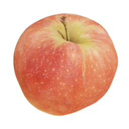</a> <b><a href="3DApple001">3D Apple 001</a></b> by ambientCG · <a href="https://ambientcg.com/a/3DApple001">source</a> | <a href="3DApple002">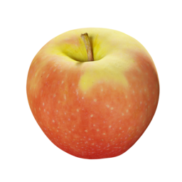</a> <b><a href="3DApple002">3D Apple 002</a></b> by ambientCG · <a href="https://ambientcg.com/a/3DApple002">source</a> | <a href="3DApple003">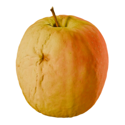</a> <b><a href="3DApple003">3D Apple 003</a></b> by ambientCG · <a href="https://ambientcg.com/a/3DApple003">source</a> | <a href="3DAvocado001">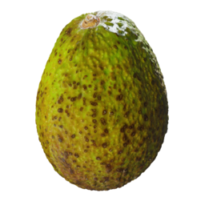</a> <b><a href="3DAvocado001">3D Avocado 001</a></b> by ambientCG · <a href="https://ambientcg.com/a/3DAvocado001">source</a> |
| <a href="3DBread001">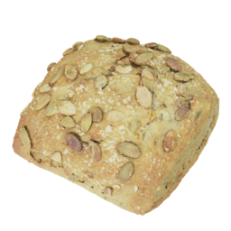</a> <b><a href="3DBread001">3D Bread 001</a></b> by ambientCG · <a href="https://ambientcg.com/a/3DBread001">source</a> | <a href="3DBread002">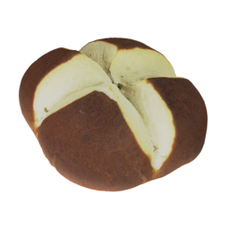</a> <b><a href="3DBread002">3D Bread 002</a></b> by ambientCG · <a href="https://ambientcg.com/a/3DBread002">source</a> | <a href="3DBread003">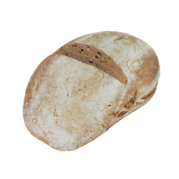</a> <b><a href="3DBread003">3D Bread 003</a></b> by ambientCG · <a href="https://ambientcg.com/a/3DBread003">source</a> | <a href="3DBread004">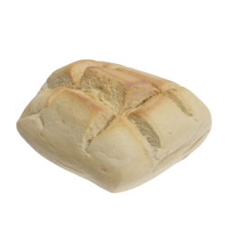</a> <b><a href="3DBread004">3D Bread 004</a></b> by ambientCG · <a href="https://ambientcg.com/a/3DBread004">source</a> |
| <a href="3DBread005">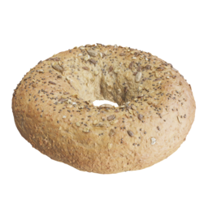</a> <b><a href="3DBread005">3D Bread 005</a></b> by ambientCG · <a href="https://ambientcg.com/a/3DBread005">source</a> | <a href="3DBread006">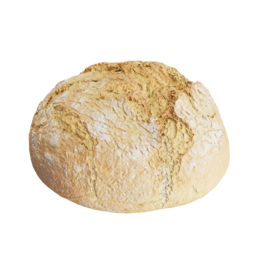</a> <b><a href="3DBread006">3D Bread 006</a></b> by ambientCG · <a href="https://ambientcg.com/a/3DBread006">source</a> | <a href="3DBread007">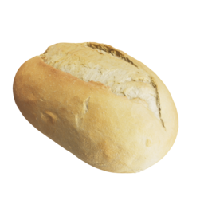</a> <b><a href="3DBread007">3D Bread 007</a></b> by ambientCG · <a href="https://ambientcg.com/a/3DBread007">source</a> | <a href="3DBread008">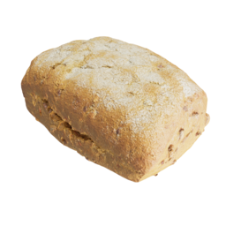</a> <b><a href="3DBread008">3D Bread 008</a></b> by ambientCG · <a href="https://ambientcg.com/a/3DBread008">source</a> |
| <a href="3DBread009">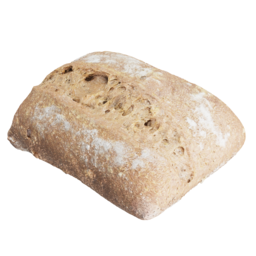</a> <b><a href="3DBread009">3D Bread 009</a></b> by ambientCG · <a href="https://ambientcg.com/a/3DBread009">source</a> | <a href="3DBread010">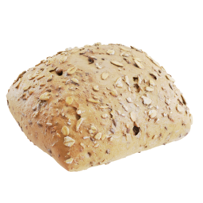</a> <b><a href="3DBread010">3D Bread 010</a></b> by ambientCG · <a href="https://ambientcg.com/a/3DBread010">source</a> | <a href="3DBread011">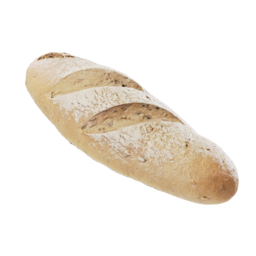</a> <b><a href="3DBread011">3D Bread 011</a></b> by ambientCG · <a href="https://ambientcg.com/a/3DBread011">source</a> | <a href="3DBread012">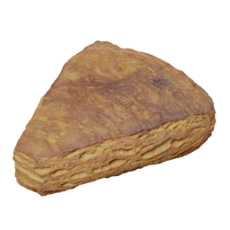</a> <b><a href="3DBread012">3D Bread 012</a></b> by ambientCG · <a href="https://ambientcg.com/a/3DBread012">source</a> |
| <a href="3DBread013">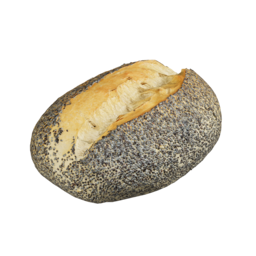</a> <b><a href="3DBread013">3D Bread 013</a></b> by ambientCG · <a href="https://ambientcg.com/a/3DBread013">source</a> | <a href="3DCake001">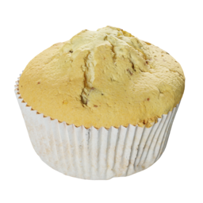</a> <b><a href="3DCake001">3D Cake 001</a></b> by ambientCG · <a href="https://ambientcg.com/a/3DCake001">source</a> | <a href="3DCookie001">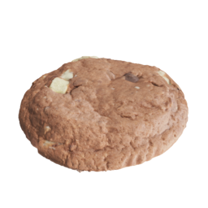</a> <b><a href="3DCookie001">3D Cookie 001</a></b> by ambientCG · <a href="https://ambientcg.com/a/3DCookie001">source</a> | <a href="3DCookie002">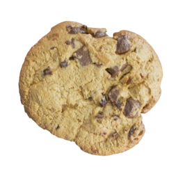</a> <b><a href="3DCookie002">3D Cookie 002</a></b> by ambientCG · <a href="https://ambientcg.com/a/3DCookie002">source</a> |
| <a href="3DCucumber001">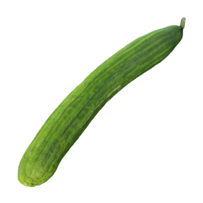</a> <b><a href="3DCucumber001">3D Cucumber 001</a></b> by ambientCG · <a href="https://ambientcg.com/a/3DCucumber001">source</a> | <a href="3DKiwi001">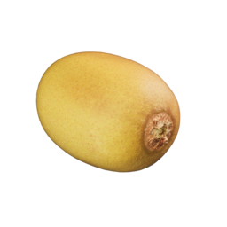</a> <b><a href="3DKiwi001">3D Kiwi 001</a></b> by ambientCG · <a href="https://ambientcg.com/a/3DKiwi001">source</a> | <a href="3DLemon001">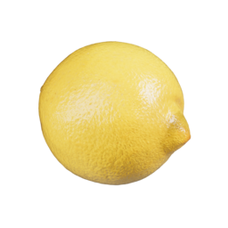</a> <b><a href="3DLemon001">3D Lemon 001</a></b> by ambientCG · <a href="https://ambientcg.com/a/3DLemon001">source</a> | <a href="3DMango001">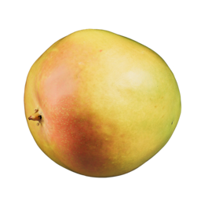</a> <b><a href="3DMango001">3D Mango 001</a></b> by ambientCG · <a href="https://ambientcg.com/a/3DMango001">source</a> |
| <a href="3DMelon001">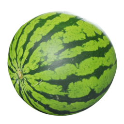</a> <b><a href="3DMelon001">3D Melon 001</a></b> by ambientCG · <a href="https://ambientcg.com/a/3DMelon001">source</a> | <a href="3DPastry001">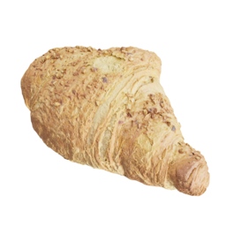</a> <b><a href="3DPastry001">3D Pastry 001</a></b> by ambientCG · <a href="https://ambientcg.com/a/3DPastry001">source</a> | <a href="3DPastry002">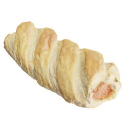</a> <b><a href="3DPastry002">3D Pastry 002</a></b> by ambientCG · <a href="https://ambientcg.com/a/3DPastry002">source</a> | <a href="3DPastry003">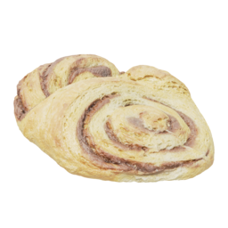</a> <b><a href="3DPastry003">3D Pastry 003</a></b> by ambientCG · <a href="https://ambientcg.com/a/3DPastry003">source</a> |
| <a href="3DPear001">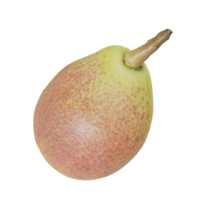</a> <b><a href="3DPear001">3D Pear 001</a></b> by ambientCG · <a href="https://ambientcg.com/a/3DPear001">source</a> | <a href="3DPear002">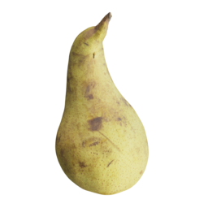</a> <b><a href="3DPear002">3D Pear 002</a></b> by ambientCG · <a href="https://ambientcg.com/a/3DPear002">source</a> | <a href="3DPear003">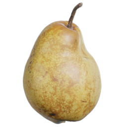</a> <b><a href="3DPear003">3D Pear 003</a></b> by ambientCG · <a href="https://ambientcg.com/a/3DPear003">source</a> | <a href="3DPear004">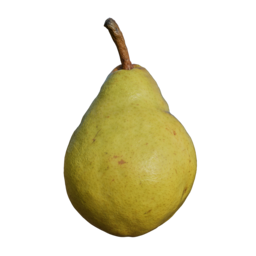</a> <b><a href="3DPear004">3D Pear 004</a></b> by ambientCG · <a href="https://ambientcg.com/a/3DPear004">source</a> |
| <a href="3DStick001">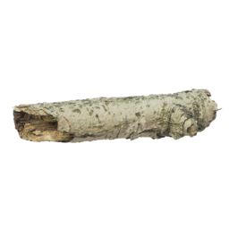</a> <b><a href="3DStick001">3D Stick 001</a></b> by ambientCG · <a href="https://ambientcg.com/a/3DStick001">source</a> | <a href="3DTreeStump001">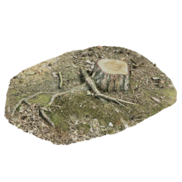</a> <b><a href="3DTreeStump001">3D Tree Stump 001</a></b> by ambientCG · <a href="https://ambientcg.com/a/3DTreeStump001">source</a> |  |  |

---

Kept up to date by this repository's own [update workflow](.github/workflows/update.yml), with code and plan from [cc0-mirror](https://github.com/zuujis-cc0/cc0-mirror). Something wrong? [Open an issue there](https://github.com/zuujis-cc0/cc0-mirror/issues/new) or use the [private report form](https://games.zuujis.com/report).
